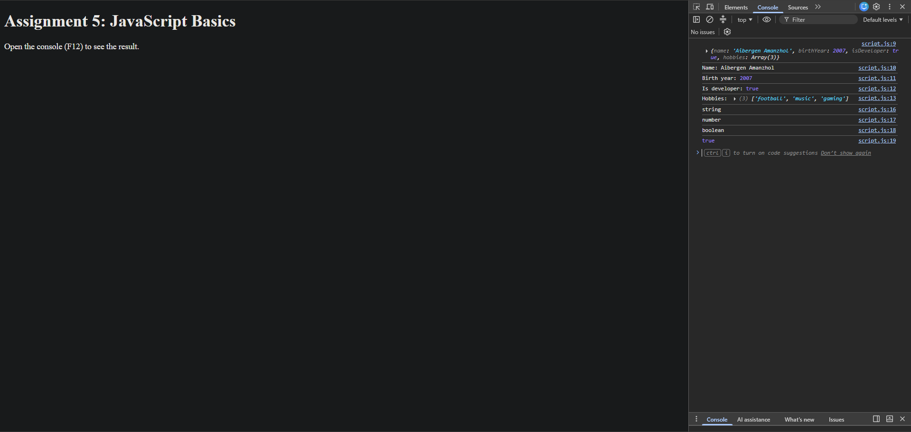
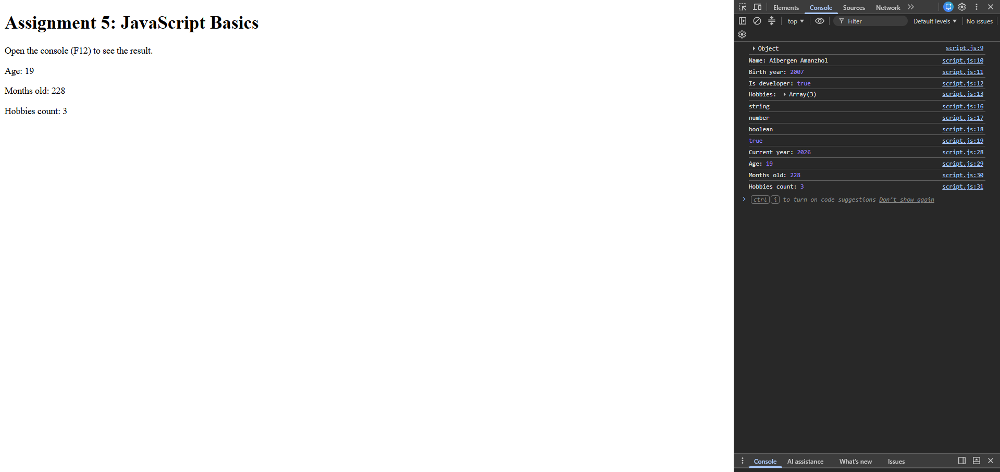
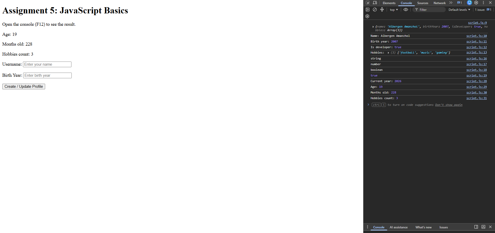
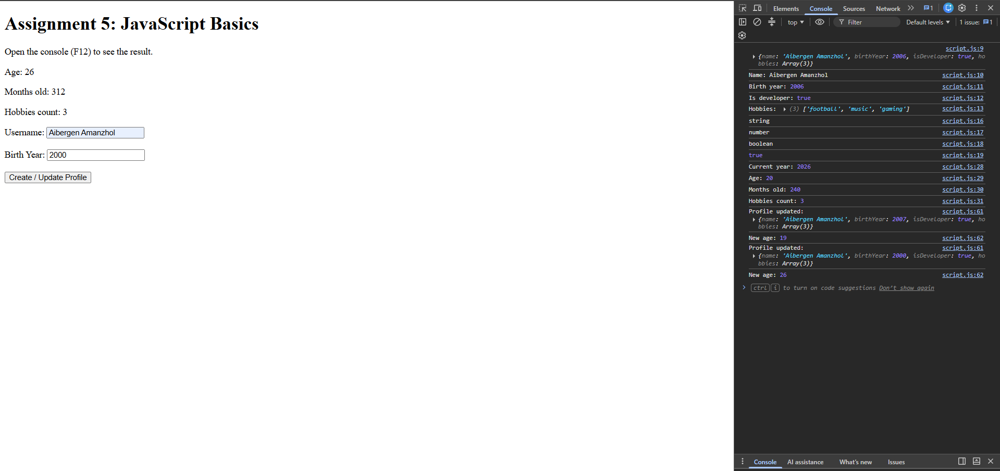
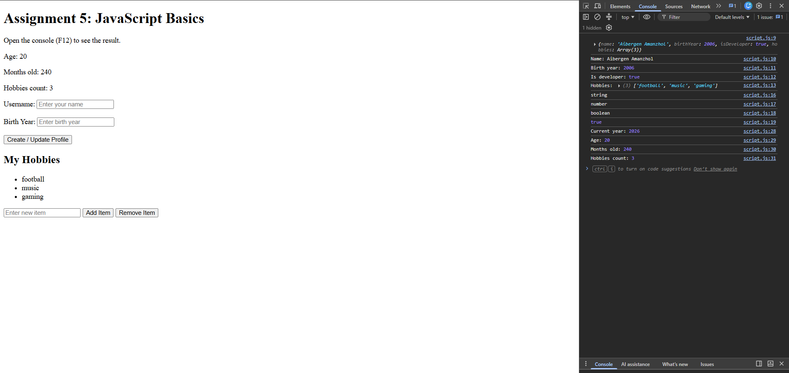
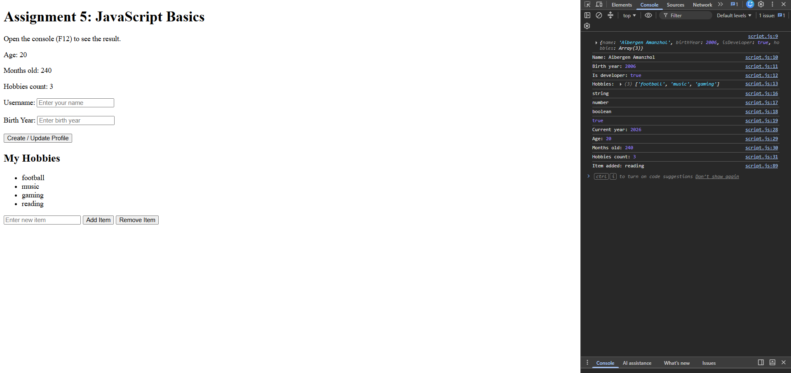
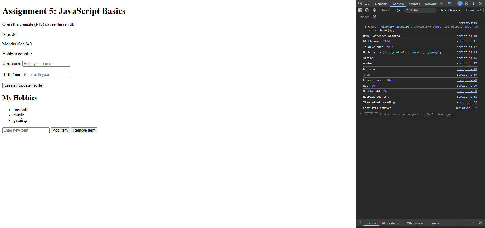

# Assignment 5. JavaScript Basics (DOM Manipulation & Events)

Name: Aibergen Amanzhol
Group: SE-2538

In this assignment I made a small web page with JavaScript. The page has a user profile object, a form that updates the profile, and a list where I can add and remove items.

Files in the project:
- index.html
- script.js
- screenshot folder with all screenshots

## Part 1: Profile Object, Data Types & Arithmetic

### Task 1. The Personal Info Object

I created a const object named userProfile. It stores a string (name), a number (birthYear), a boolean (isDeveloper) and an array (hobbies). After that I printed the object and each of its values in the console. I also used typeof and Array.isArray to check the data types.

### Task 2. Arithmetic Calculations

I used the arithmetic operators to calculate the age. The current year is taken from new Date().getFullYear(), then I subtract birthYear from it, so the age is calculated dynamically. Then I calculated how many months old the user is (age * 12) and the number of hobbies with hobbies.length. The values are shown in the console and on the page.

## Part 2: Form Input & Event Responses

### Task 3. HTML Form Setup

I made a form with an input for Username, an input for Birth Year and a "Create / Update Profile" submit button.

### Task 4. Event Listener

I added a submit event listener to the form. When the button is clicked, the script takes the values from the inputs and updates the userProfile object (name and birthYear). I used event.preventDefault() so the page does not reload. The birth year from the input is a string, so I changed it to a number with Number(). After the update the age and months are calculated again and shown on the page, and the new object is printed in the console. If some field is empty, the page shows an alert.

## Part 3: DOM List Manipulation

### Task 5. Creating & Removing Elements

I made an unordered list (ul) with my hobbies. There is an input field and two buttons.

The "Add Item" button takes the text from the input, creates a new li element with document.createElement and adds it to the end of the list with appendChild. If the input is empty, it shows an alert.

The "Remove Item" button deletes the last item of the list with removeChild. If the list is empty, it shows an alert.

Screenshot of the list at the start:

Screenshot after adding a new item:

Screenshot after removing the last item:

## Summary of my work process

First I created a folder for the project with index.html and script.js. I did the tasks one by one and after each task I opened the page with Live Server, checked the result in the browser and in the console (F12) and made a screenshot. I used the lecture slides about JavaScript basics and the DOM to understand variables, objects, type coercion, getElementById, addEventListener, createElement and appendChild. At the end I uploaded the project to GitHub and turned on GitHub Pages.

## Conclusion

In this assignment I learned how to store data in a JavaScript object and how to use different data types. I practiced arithmetic operators and calculated the age dynamically. I also learned how to get values from a form, how to use event listeners and how to change the page without reloading it. In the last task I practiced creating and removing HTML elements with the DOM. The most useful thing for me was to understand that the DOM lets JavaScript change a page after it is loaded. I think this assignment is a good base for the next topics of the course.